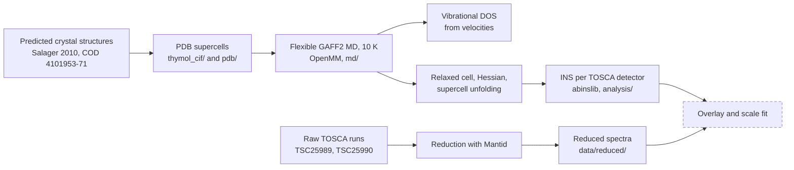

# Thymol: from a crystal structure to a simulated neutron spectrum

MSc thesis workspace. The aim is to predict the **inelastic neutron scattering (INS) spectrum of crystalline thymol** (C10H14O) from a classical force field, and to compare it with a measured spectrum from the TOSCA spectrometer (ISIS). Everything is reproducible from one `pixi.toml`; every scientific step is written down in [`LOG.md`](LOG.md).

All energies are in **meV**.

## How the pieces fit



Dashed = not run yet. The INS code is written and tested on a small fixture, but has not yet been run on the real force constants.

## Where things stand

| Step | State |
|---|---|
| Structure choice: Structure 3 of Salager et al. (R-3, best NMR match), PDB unit cell and 2x2x1 supercell | done |
| Classical MD of the unit cell and the 2x2x1 supercell, velocity DOS in meV | done (resolved C-H stretch bands at about 376-396 meV, O-H at about 462-467 meV in the 1x1x1 DOS) |
| Hessian of the 2x2x1 supercell at a true minimum, unfolded to force constants | done (no imaginary modes; 936 C-H and 72 O-H stretch modes) |
| Harmonic thermodynamics from the DOS (U, S, F, Cv) | code and tests; numbers not yet logged |
| TOSCA reduction of the two thymol runs, method in [`data/REDUCTION.md`](data/REDUCTION.md) | done |
| INS spectrum on the real force constants, overlay with TSC25990 | **next** |
| Bayesian band model (dynesty) | planned, separate plan |

Open work is tracked in [`docs/TASKS.md`](docs/TASKS.md). Known limits: the force field is GAFF2 with AM1-BCC charges and nothing was fitted; the measured crystal structure (CSD THYMOL) has not been obtained, so the model structure is a prediction.

## Environments

One manifest, one lock file. Mantid 7 pins Python 3.13 and euphonic below 2, while abinslib needs euphonic 2 or later, so the science tools cannot share an environment. Features are combined into environments in [`pixi.toml`](pixi.toml).

| Environment | Used for | Main packages |
|---|---|---|
| `md` | simulation, DOS, notebooks | OpenMM, openmmforcefields (GAFF2), AmberTools, RDKit, MDANSE, MDAnalysis, ASE, marimo |
| `ins` | INS simulation and fitting | abinslib, resins, euphonic 2, dynesty, MDAnalysis, ASE, marimo |
| `mantid` | TOSCA data reduction | Mantid 7 and workbench, dynesty |
| `test-md`, `test-ins`, `test-mantid` | tests, same package versions as their parent | pytest on top of the parent |
| `fix` | lint, format, docstring style | ruff |

## Run it

```bash
pixi install --all                  # builds all environments (several GB)
pixi run test-unit-all              # unit tests and doctests, no simulation
pixi run test-integration-all       # slow: runs OpenMM, Mantid, AmberTools
pixi run -e fix lint                # check style (rules in ruff.toml)
pixi run -e fix fix                 # apply fixes and format

cd md
pixi run -e md marimo edit 03_dos.py              # notebooks: 01_system, 02_run, 03_dos, 04_hessian
pixi run -e md python 02_run.py -- --cell 1x1x1   # or run one as a script
```

The test and fix tasks are defined but have not been run through pixi yet; the unit tests were run directly in the earlier per-folder environments.

## Repository map

| Path | Contents |
|---|---|
| `thymol_cif/` | the 23 predicted structures (CIF) and the scripts that build and check the PDB files |
| `pdb/` | thymol unit cell (450 atoms) and 2x2x1 supercell (1800 atoms) |
| `md/` | system build, MD run, DOS, Hessian, supercell unfolding, thermodynamics; marimo notebooks `01` to `04` |
| `analysis/` | TOSCA reduction (Mantid), per-detector INS simulation (abinslib), comparison with data |
| `data/` | reduced TOSCA spectra, detector table, reduction notes (raw files are not in git) |
| `tests/` | `unit/` (no simulation) and `integration/` (runs the engines), one folder per area |
| `docs/` | design spec, implementation plan, tutorials, task tracker |
| `LOG.md`, `refs.bib` | dated research log; bibliography |

## Working rules

- **Test first.** Code is written after a failing test; unit tests never run a simulation.
- **Log every scientific change** in `LOG.md`, with the time taken from the shell.
- **Sources are cited** in `refs.bib`.
- **Guard rails** (Claude Code hooks in `.claude/`): a log check, a task-tracker check and a guard that blocks silently dropped packages from `pixi.toml`.
